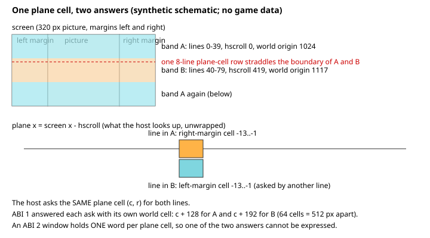

# ABI 2 scenery windows and per-line world origins

Status: finding of SEG-152-T009 (Sonic 1). Aggregate, synthetic explanation only: the real-game captures, frame numbers and word values that back it stay in local, ignored diagnostics.

## The mechanism

The host extends a frame beyond the 320-pixel picture one **off-picture pixel at a time**: for screen line `l` and column `x` outside the picture it looks up the plane cell `floor((x - hscroll(l)) / 8)` of plane row `floor((l + vscroll) / 8)`. The ABI 1 provider answered that lookup per cell with the **world** cell at `x + origin(l)`, where `origin(l)` is the world x of screen column 0 for that line (each parallax band has its own scroll). `origin(l) + hscroll(l)` is a multiple of 512 (the plane is 64 cells = 512 pixels wide), so a line's answer is the world cell `plane cell + k(l)` with `k(l) = (hscroll(l) + origin(l)) / 8`.

An ABI 2 scenery window (ADR 0309/0313) is addressed by **plane cell only**: one word per `(plane column, plane row)` for the whole frame. Two lines of the same plane-cell row that ask the same plane column with different `k` need two different words; the window can hold one. This is the "origin-multiple" class of SEG-152-T001.

## When it occurs

Only when all of the following hold in one frame: a plane with per-line scroll, two lines of one 8-line cell row whose off-picture pixel ranges overlap in plane coordinates (their `hscroll` values differ by less than the picture plus margins), and different `k` (their world origins differ by a multiple of 512 pixels). The Sonic 1 case: in the lower background region the game scrolls every line by a different amount; as that ramp advances, the nearest-alias world origin of adjacent lines flips by 512 pixels, so the two lines at the flip share a cell row and ask the same cells at origins 512 px apart. Sonic 2's measured scenes have no such pair (zero conflicts in every compared frame of both revisions); Sonic 1's Green Hill Zone has one in most frames (3,436 of 4,064 and, by refusal, 2,898 of 3,775 authored frames in two scripted runs).

## How it was verified (local; the evidence itself is not published)

* An instrumented copy of the port (the same builder plus log lines) records, per refused frame, the conflicting plane-cell rows, the two line ranges, their scrolls, shifts and the cell columns; refused frames and logged conflict frames are the same set.
* An independent re-computation (`tools/sonic1_conflict_diagnosis.py`, written from the game's work RAM and the layout formulas, not from the port) recovers the same cells, rows and the two different words from the RAM of the previous onset, and finds none where the port serves the scenery.
* Pictures: where the port serves the scenery it equals ABI 1 pixel for pixel; where it refuses, the difference is the whole generic fallback of the frame (tens of thousands of pixels), far larger than the few conflicting cell rows that cause it.

## What it is not

* Not a camera or coordinate error: where no such pair exists the ABI 2 port reproduces the ABI 1 pictures pixel for pixel.
* Not a window-construction artefact: the instrumented port and an independent re-computation from the game's work RAM name the same conflicting cells and the same two words.
* Not expressible by the per-row generic mask: the mask answers a line with the VDP's own plane word, which is not the world cell ABI 1 served in the margin.
